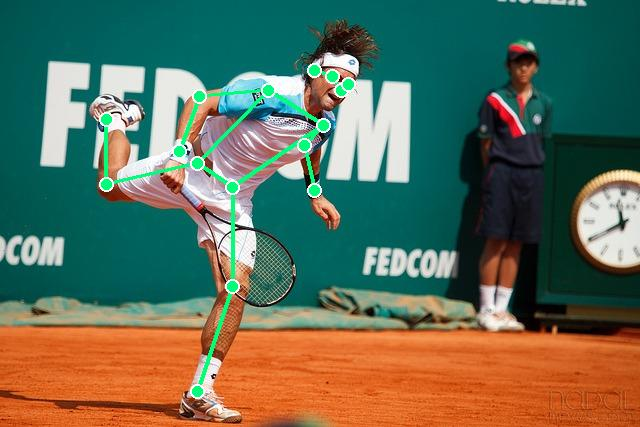
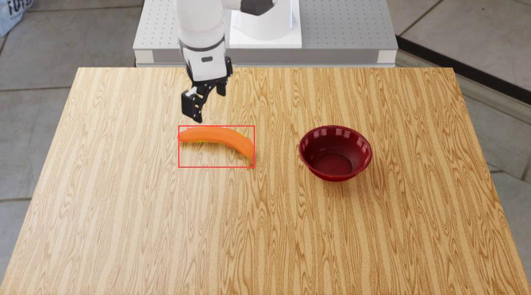

# body-pose-vlm（中文）

<p align="center">
  
  
</p>

**能用自然语言指挥的人体关键点大模型。** 你想问谁就问谁——返回 COCO-17 命名的关键点 JSON。同一个模型还会指代分割：

<p align="center">
  
</p>

与传统姿态估计（检测器 → N 人 × 固定骨架，无语义）不同，`body-pose-vlm` 是**视觉-语言生成式**模型：选哪个实例、要哪些部位、输出多细粒度，全部由你的提问决定，结果直接是结构化 JSON，下游控制代码即取即用。

## 亮点

| | |
|---|---|
| 🎯 自然语言寻址 | leftmost / rightmost / 第 N 个人 / 属性（"长发者"）/ 动作意图（"要去抓杯子的手"） |
| 🧩 粒度可变 | 全身 17 点、单臂三点（肩-肘-腕）、只要手腕一个点——随问随变 |
| 📐 结构化输出 | `[{"name":"left_wrist","point":[x,y]}, ...]`，坐标归一化 0–1000，评测 JSON 合法率 100% |
| 🔀 零样本泛化 | 视线方向、外观属性类指代未经专门训练即可用 |
| 🖼️ 一机多能 | 关键点 + 目标框 grounding + 指代分割，同一个 3B 模型 |

## 模型信息

- **作者：** forky
- **权重：** ~9.9 GB（bf16，总参数 4.6B）
- **评测（COCO val 子集）：** box IoU 0.744 · PCK@0.1 0.330 · JSON 合法率 1.000
- **下载（魔搭 ModelScope，国内推荐）：**
  ```bash
  pip install modelscope
  modelscope download --model fengforky/body-pose-vlm --local_dir ./weights
  ```
  页面地址：<https://www.modelscope.cn/models/fengforky/body-pose-vlm>

## 安装

```bash
# python >= 3.10，CUDA >= 12.4，单卡显存 >= 16GB（L20/4090/A100 均可）
conda create -n bodypose python=3.10 -y && conda activate bodypose
pip install torch==2.7.* torchvision --index-url https://download.pytorch.org/whl/cu128
pip install transformers>=4.57 fastapi uvicorn pillow numpy requests
pip install flash-attn --no-build-isolation        # 可选，强烈推荐
```

模型结构代码就在本仓库 `src/body_pose_vlm/` 内，推理不需要额外训练框架。

## 服务的启动 / 停止

```bash
# 启动（默认端口 8600）
CUDA_VISIBLE_DEVICES=0 python serve.py --model ./weights --port 8600 &

# 健康检查
curl http://localhost:8600/healthz      # -> {"ok": true}

# 停止
kill %1                                 # 或 pkill -f serve.py
```

systemd 常驻方式：

```ini
# ~/.config/systemd/user/bodypose.service
[Unit]
Description=body-pose-vlm server
[Service]
Environment=CUDA_VISIBLE_DEVICES=0
ExecStart=/path/to/conda/envs/bodypose/bin/python /path/to/serve.py --model /path/to/weights --port 8600
Restart=on-failure
[Install]
WantedBy=default.target
```
```bash
systemctl --user daemon-reload
systemctl --user start bodypose     # 停止：systemctl --user stop bodypose
```

## Python 客户端样例

```bash
python client.py --url http://localhost:8600/v1 \
    --image demo.jpg \
    --query "Report all visible human body keypoints of the leftmost person. Use COCO keypoint names, coordinates normalized to 0-1000 as [x, y]."
```

OpenAI 兼容报文（任何 HTTP 库都能发）：

```python
import base64, requests

b64 = base64.b64encode(open("demo.jpg", "rb").read()).decode()
r = requests.post("http://192.168.1.76:8600/v1/chat/completions", json={
    "model": "body-pose-vlm",
    "messages": [{"role": "user", "content": [
        {"type": "image_url", "image_url": {"url": f"data:image/jpeg;base64,{b64}"}},
        {"type": "text", "text": "What are the keypoint coordinates of the right arm (shoulder, elbow, wrist) of the second from the left person? Coordinates normalized to 0-1000 as [x, y]."},
    ]}],
}, timeout=120)

data = r.json()
print(data["choices"][0]["message"]["content"])  # 助手文本（含 JSON）
print(data["keypoints_permille"])                  # {"right_shoulder":[..],...} 归一化坐标
print(data["keypoints_pixels"])                    # 原图像素坐标
```

更多提问句式见 [`client_examples.md`](client_examples.md)。中文提问也支持（如「只输出中间那个人的左手手臂的关键点」）。

## 训练配方（简述）

`body-pose-vlm` 是在强预训练视觉-语言基座上的一次定向 SFT，把关键点重铸为**「坐标即文本」**的生成任务：

- **数据**：COCO-Keypoints 改造成指令对——四类样本（人体 grounding / 全骨架 / 单臂三点 / 仅腕点），遮挡点不请求，多人场景按 bbox 排序自动合成序数/方位指代——这正是"用语言挑人"能力的来源。
- **训练**：全参数 SFT 1 epoch（约 1.8 万步），lr 1e-5 cosine，bf16 + ZeRO-2；只在 assistant 段计损失。视觉编码器几乎全冻、语言输出头纹丝不动——**我们刻意保住感知栈和整个词表，让 grounding 与分割能力在专业化之后完好无损**。真正适应新任务的只有视觉-语言接口层及其上游主干。
- **协议**：坐标落在 resize 后画布上并量化到 [0,1000]，与基座原生 `<bbox>` 协议同一套整数 token 约定——关键点、目标框、掩码共享一套输出语法。

细节略。值得强调的是：**冻结的掩码解码头 + 冻结的词表就够了——没加任何新头、没有新增一个参数**，距离一个姿态 VLM 只差一次输出协议设计。

## 已知局限（诚实版）

- 「把每个人的右手都列出来」这类一对多枚举不可靠——训练样本都是单目标，请逐人轮询后在客户端合并。
- 属性/动作指代（"长发""拿拍的手"）零样本可用但未标定，人多、目标小时会翻车。
- 绝对精度不及专用姿态网络；本模型的卖点是**语言可寻址 + 统一协议**，不是刷榜。

## 许可与商用说明 ⚠️

- **个人使用、学术研究、教学演示：免费**，无需申请。
- **商业使用（产品集成、对外服务、闭源分发等）：需事先书面授权**。请通过 GitHub Issues / 邮箱联系作者 **forky** 提交商用申请，说明用途与范围；获批后可提供正式授权文件。
- 本模型基于 **Xiaomi-Lens**（小米公司 ModelCloud/Xiaomi-VLM）微调而来，权重与代码同时受基座开源许可条款约束；再分发时请保留致谢与许可声明。

## 致谢

本项目构建于 **Xiaomi-Lens** 之上，衷心感谢小米团队开源了如此出色的多模态基础模型。

---

📌 English version: [README_en.md](README_en.md) · GitHub 仓库同步更新，模型权重托管于魔搭社区。

---
